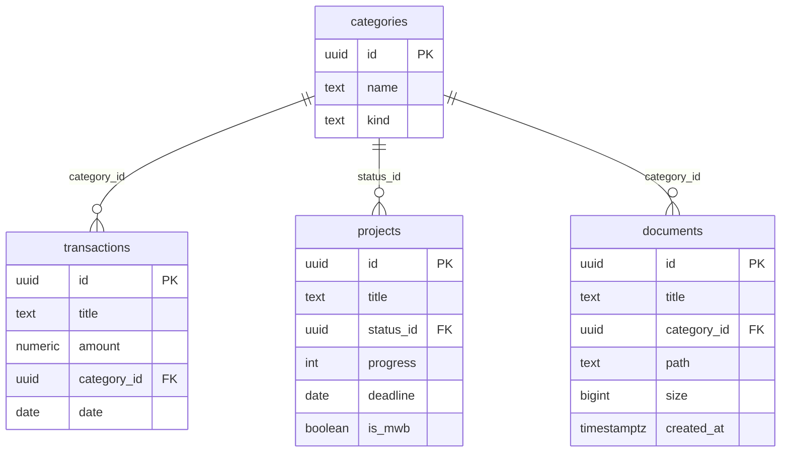

# ORBIT / Personal Finance & Productivity OS

Aplikasi single-owner dengan antarmuka ultra-dark, Next.js App Router, React, Tailwind CSS 4, Supabase PostgreSQL dan private Storage. Bahasa UI Indonesia, nominal IDR, tanggal lokal Asia/Jakarta.

## 1. Skema relasional

Jalankan `supabase/schema.sql` sekali pada database Supabase baru lewat SQL Editor **sebelum menjalankan aplikasi**.



Jenis kategori: income, expense, status, document. Penghapusan kategori yang dipakai ditolak foreign key. Jenis kategori tersimpan tidak dapat diubah melalui API; nama dapat diedit. Jumlah transaksi selalu positif; arah arus kas ditentukan jenis kategori. Total saldo dihitung dari seluruh pemasukan dikurangi pengeluaran. File disimpan di bucket privat `vault`; database menyimpan metadata. Unduhan memakai signed URL 60 detik. SQL ini bootstrap sekali, bukan migrasi idempotent.

## 2. Arsitektur dan modul

- `app/page.tsx`: memverifikasi session pada server.
- `components/workspace.tsx`: dashboard, grafik 7 hari, CRUD transaksi, tabel proyek dengan pencarian/filter/sort, kalender bulanan interaktif, upload/download/hapus dokumen, master kategori.
- `app/api/login`, `logout`: login admin dan session JWT 8 jam dalam cookie HttpOnly, SameSite=Strict, Secure pada produksi.
- `app/api/data`: API CRUD tervalidasi dengan pemeriksaan session dan origin untuk mutation.
- `app/api/files`: upload maksimal 10 MB (PDF/JPG/PNG/TXT), download privat.
- `lib/server.ts`: Supabase server-only dan helper autentikasi.
- `supabase/schema.sql`: tabel, constraint, index, RLS, kategori awal, private bucket.

RLS aktif tanpa public policy. Browser tidak memiliki akses database langsung. Semua akses melewati server Next.js menggunakan service role. Ini workspace untuk **satu admin**, bukan aplikasi multi-tenant. Service role dan session secret tidak boleh memakai prefix NEXT_PUBLIC_.

## 3. Pengembangan lokal

Node.js 22 atau 24, npm.

```sh
cd /workspace/Personal_OS
npm ci
cp .env.example .env.local
```

Isi `.env.local` secara privat:

| Variable | Isi |
| --- | --- |
| SUPABASE_URL | Project URL dari Supabase Settings → API |
| SUPABASE_SERVICE_ROLE_KEY | Legacy service_role key atau server secret key project |
| SESSION_SECRET | String acak minimal 32 karakter; buat dengan `openssl rand -hex 32` |
| ADMIN_USERNAME | `admin` |
| ADMIN_PASSWORD | `admin` sesuai permintaan; ganti sebelum dipakai menyimpan data nyata |

```sh
npm run dev
npm run typecheck
npm run build
npm start
```

`npm start` digunakan setelah build dan menggantikan dev server, bukan bersamaan pada port yang sama. Jangan commit `.env.local`. Tanpa Supabase, login tetap bisa diverifikasi dengan session secret tetapi operasi data menampilkan error konfigurasi, bukan data simulasi.

## 4. Deploy Supabase + Vercel

1. Buat project Supabase, simpan password database secara aman. Jalankan SQL bootstrap di SQL Editor dan pastikan tabel serta bucket `vault` tersedia.
2. Push repository ini ke GitHub dari akun Anda. Tidak ada credential yang perlu ditambahkan ke repository.
3. Di Vercel pilih **Add New → Project → Import Git Repository**. Framework Next.js, root directory root repository, install `npm ci`, build `npm run build`.
4. Tambahkan kelima environment variables di atas pada Vercel untuk Production (dan Preview bila ingin menguji preview). Buat session secret tersendiri. Jangan tulis nilai rahasia ke chat atau file tracked.
5. Deploy. Jika environment variables diperbarui setelah deployment, lakukan Redeploy.
6. Buka domain HTTPS yang diberikan Vercel dan login `admin` / `admin` jika belum diganti.
7. Verifikasi: tambah pemasukan/pengeluaran, refresh dan cek persistensi saldo; edit/hapus transaksi; buat proyek MWB dan cek tanggal pada kalender; upload PDF, download dan bandingkan isi; buat/edit kategori; pastikan penghapusan kategori terpakai ditolak; logout dan pastikan akses API ditolak.

Next.js tidak memerlukan filesystem persisten Vercel: data dan file tersimpan di Supabase. Koneksi memakai HTTPS Supabase API sehingga tidak memerlukan database connection pool/connection string. Tidak perlu Supabase Auth untuk single-admin session ini.

Smoke test autentikasi: jalankan `node tests/auth-smoke.mjs` saat production server aktif dengan session secret. Test ini tidak memverifikasi operasi Supabase.

## 5. Batasan operasional

- Default `admin/admin` lemah. Ubah ADMIN_PASSWORD sebelum penggunaan dengan data keuangan nyata dan rotasi SESSION_SECRET untuk membatalkan session lama.
- Login memiliki pembatas percobaan per proses (10 percobaan / 15 menit), bukan limiter terdistribusi. Untuk publik produksi, aktifkan Vercel Firewall/rate limiting pada `/api/login` sebelum menerima traffic umum.
- Upload dan insert metadata memakai dua layanan; kegagalan insert mencoba membersihkan file. Penghapusan menghapus file dahulu. Bila penghapusan metadata gagal setelah file terhapus, coba ulang atau bersihkan metadata orphan melalui dashboard Supabase.
- Tidak ada sinkronisasi bank, OCR, multi-user, atau recurring transaction; ledger dikelola manual.
- Pengujian build dan auth tidak membuktikan persistensi Supabase. Uji integrasi langkah 7 memerlukan project dan credential nyata.

## 6. Environment cloud

Gunakan checkout yang sudah ada; task sudah terisolasi, tidak perlu membuat worktree. Jalankan `npm ci` untuk menyiapkan dependensi. Saat task baru dimulai, baca README dan konfigurasi private environment sebelum menjalankan server. Jangan mengasumsikan proses server hidup setelah snapshot dipulihkan.

## Desain UI monokrom

Token Tailwind, referensi visual, dan penggunaan font Coolvetica lokal dijelaskan di [docs/DESIGN.md](docs/DESIGN.md). File font dari ZIP berlisensi desktop tidak didistribusikan sebagai webfont.
